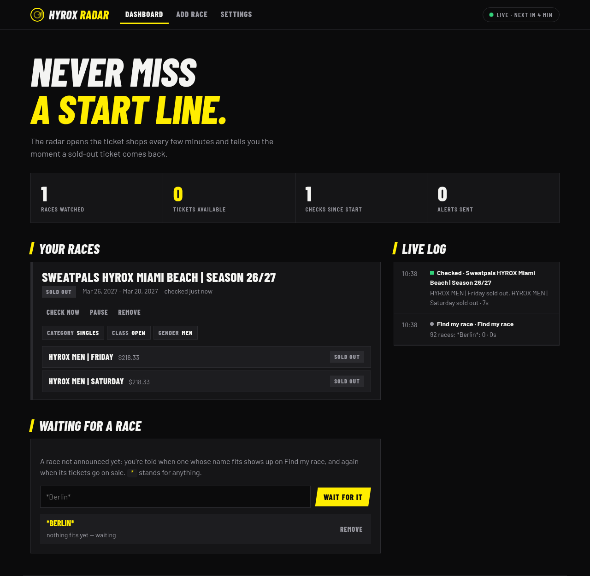
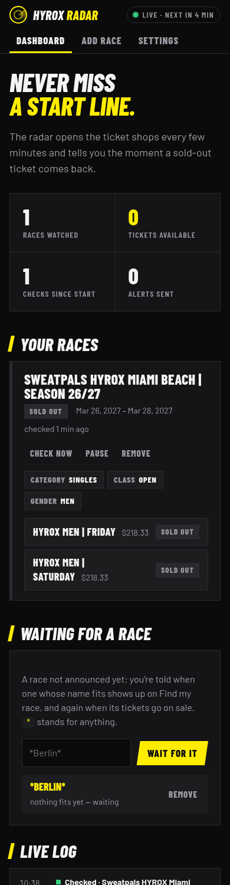

# HYROX Radar

[](CHANGELOG.md)
[](LICENSE)
[](https://go.dev)

**Never miss a start line.** Your race sold out? Tickets come back — people get injured, swap
days, change plans — and they're gone again within minutes. HYROX Radar watches the ticket shops
for you and sends a notification the moment the ticket you want can be bought.

<p align="center">
  
</p>

One small Go program with a dashboard in the browser, made to run around the clock on a
Raspberry Pi or any Linux box:

| | |
|---|---|
| 🎯 **Any race, any ticket** | Pick the race from HYROX's *Find my race*, make the same choices as in its shop — Singles › Open › Men — and tick the tickets you want: Friday, Saturday, or any of them. |
| 🔔 **Told at once** | Pushover (all your devices, or just one) and email. Once per ticket coming back, not every few minutes while it lasts. |
| 🗓️ **Races not announced yet** | Wait for `*Berlin*`: you're told when a race whose name fits shows up, and again when its tickets go on sale. |
| 📡 **A dashboard** | What is watched, what is sold out or available, what is being checked right now, when the next round is, and a live log. |
| 🛟 **Tells you when it breaks** | Three failed checks in a row — the shop changed, the race is gone — and you get told, and again once it works. |

## How it works

```
   Find my race ──────────────►  races to pick from, and new ones for your searches
   hyrox.com/find-my-race          (plain page, read every half hour)

   Ticket shop  ──── Chromium ──►  Buy Tickets › Singles › Open › Men
   (vivenu, per region)   headless   every ticket listed: available or not, and its price
                                         │
                                         ▼
                                   hyrox-radar ── a ticket you want came back? ──► Pushover
                                   :8590 dashboard                                 Email
```

The ticket shops build their pages in the browser, so the radar opens them the way you would: in
headless Chromium, clicking *Buy Tickets* and then your choices, and reading which tickets say
*Unavailable*. One shop at a time, every 5 minutes by default — about 7 seconds per race on a
Raspberry Pi 5. It never logs in, never adds anything to a cart and never buys.

## Install

You need Go 1.25 or newer to build it, and Chromium (or Chrome) where it runs.

```sh
sudo apt install chromium            # Raspberry Pi OS, Debian, Ubuntu
go install github.com/rummeyer/hyrox-radar@latest
hyrox-radar                          # dashboard on http://<this machine>:8590
```

Or from a clone: `go build && ./hyrox-radar`.

### Run it as a service

[`hyrox-radar.service`](hyrox-radar.service) keeps it running and starts it at boot. Set `User=`
to yours and `ExecStart=` to where the binary is, then:

```sh
sudo cp hyrox-radar.service /etc/systemd/system/
sudo systemctl enable --now hyrox-radar
journalctl -u hyrox-radar -f         # what it is doing
```

### Options

| Flag | Default | |
|---|---|---|
| `-listen` | `:8590` | Address of the dashboard |
| `-data` | `~/.hyrox-radar` | Where the races, searches and settings are kept (`radar.json`, readable only by you) |
| `-chromium` | found on the `PATH` | Chromium or Chrome to use |
| `-version` | | Print the version |

## Using it

1. **Settings** — switch on Pushover and/or email and send yourself a test.
   - *Pushover*: the app token from [pushover.net → Your Applications](https://pushover.net/apps/build)
     and your user key. *Send to* lists your devices, to alert just one phone.
   - *Email*: any SMTP server — port 587 with STARTTLS, or 465 with TLS. Several addresses
     with commas.
2. **Add race** — choose the race, then *Singles*, *Open*, *Men* and so on as the shop asks.
   Each step opens the shop afresh, so give it a few seconds. Tick the tickets you want and
   *Start watching*. None ticked means any of them.
3. **Dashboard** — your races with their tickets. *Check now* looks at once, *Pause* stops
   watching for a while.
4. **Waiting for a race** — enter a name with `*` for anything: `*Berlin*`, `*Hamburg*`,
   `*Miami*`. Races there already when you add it are not news; a new one is, and so is its
   tickets going on sale.

<p align="center"></p>

### The alert

> **Tickets available: Sweatpals HYROX Miami Beach**
> HYROX MEN | Friday $218.33
> Be quick.
> *Open ticket shop*

Pushover alerts are sent with high priority, so they come through quiet hours. Tap the link,
pick the ticket, pay — returned tickets go fast.

## Good to know

- **Keep the dashboard to your network.** It has no login, and it is where the Pushover keys
  and the email password are set (it never shows them again once saved). Don't forward its port
  to the internet.
- **Not too often.** Every 5 minutes is plenty and fair to the shops; 2 minutes is the least.
- **Shops change.** The radar reads the shops' current pages. If HYROX's shop is rebuilt, checks
  fail and you're told — then it needs an update here.
- **It reads, it doesn't reserve.** You still have to be quick yourself.

## Development

```sh
go test ./...
go run . -data /tmp/radar -listen :8591
```

`shop.go` drives the shop, `events.go` reads Find my race, `radar.go` decides what is news,
`notify.go` and `pushover.go` send it, `server.go` and `web/` are the dashboard.

## Not affiliated

HYROX Radar is an independent hobby project. It is not affiliated with, endorsed by or connected
to HYROX or vivenu. HYROX is a trademark of its owner. The radar only reads public pages, as a
visitor's browser would.

## License

[MIT](LICENSE) © 2026 Oliver Rummeyer
